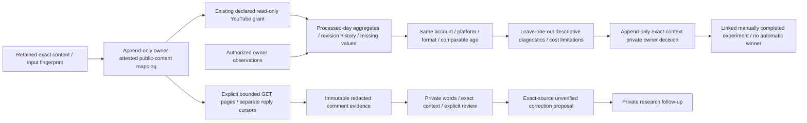
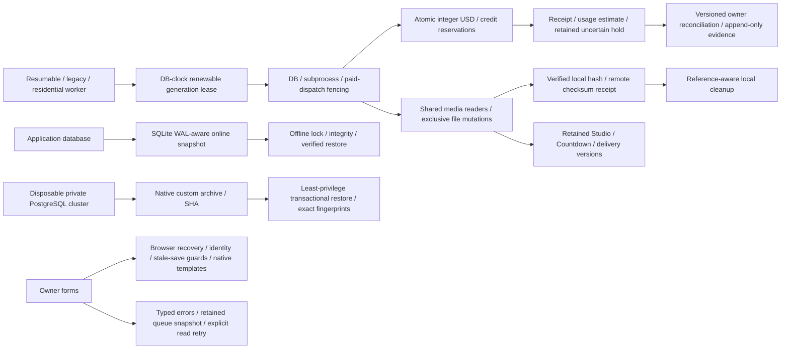
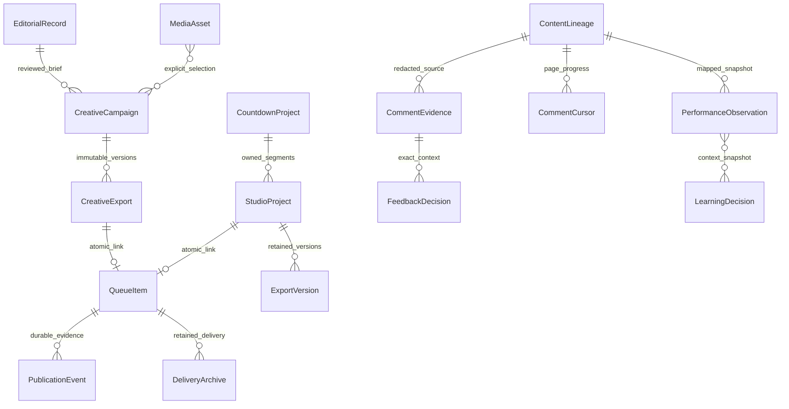

# Current local revival architecture — October 19, 2026

This describes the implemented local branch, not a deployed Screen Central OS
release. C01–C14 remain tracked in [REMAINING_ROADMAP.md](REMAINING_ROADMAP.md).
Continue local implementation, MEMORY.md and local commits without checkpoint
approval. The owner authorized GitHub push, deployment and live testing **when
implementation is finished**. No main merge, public media publication, account
change or paid call follows from that instruction. The later request defers the
entire Shorts archive and Drive login; those paths must stay idle.

Solid arrows are code paths. External adapters are replaced at the provider
boundary in local E2E. Actual databases, HTTP, UI, FFmpeg, original generated
assets and installed offline speech run locally; fixture success does not prove
provider compatibility, factual accuracy, permissions or creative quality.

```mermaid
flowchart LR
  UI[Next owner interface] --> AUTH[Owner header / scoped binary media pass]
  AUTH --> API[FastAPI lifespan / fail-closed initialization]
  API --> LF[Studio staged attempts]
  LF --> FACT[Typed metadata / claim references]
  FACT --> FETCH[Immutable independently retrieved source records]
  FETCH --> REVIEW[Owner semantic verdict / freshness / conflicts]
  REVIEW --> SCRIPT[Saved narration gate / recheck after edits]
  SCRIPT --> PLAN[Shots / plan / narration]
  PLAN --> RENDER[FFmpeg export]
  API --> CD[Countdown identity / eligibility / owned segments]
  CD --> LF
  CD --> STITCH[Exact segment release / final stitch]
  STITCH --> QA[Decode / streams / duration / loudness / timed spans]
  RENDER --> QA
  API --> BRIEF[Owner research / original angle / format choices]
  BRIEF --> CAM[Native campaigns / explicit selected assets]
  ASSETS[Authorized local still / video / audio catalog] --> SEARCH[Lexical tags / owner captions / provenance]
  SEARCH --> CAM
  CAM --> NATIVE[Immutable native exports / private manual packages]
  NATIVE --> QA
  QA --> ACCEPT[Exact-file editorial checks / finding decisions / rights attestation]
  ACCEPT --> Q[Atomic review queue link]
  ACCEPT --> MANUAL[Owner-header private package download]
  Q --> JOURNAL[Generation lease / durable per-target intent]
  JOURNAL --> PROVIDER[Transport / known receipt or uncertainty]
  PROVIDER --> RECON[Read-only reconciliation / owner evidence]
  RECON --> HISTORY[Retained delivery evidence and exact bytes]
```

The catalog accepts authorized video/audio. Native Short/Reel-only campaigns
can select explicit video intervals with silent retained excerpts and intentional
hold/loop treatment. Explicit authorized background audio has separate intervals,
relative levels and silence/loop endings; audio-as-visual and incompatible mixed
formats reject. Short/Reel visual
treatments are still related beat cards. Image, carousel, community and poll have
format-specific copy; community/poll delivery is private/manual only. Native
approval now uses the same structured acceptance mechanism as the two studios,
with format-appropriate wording and full-manifest/inspection binding. Native review and format-specific transport checks passed full backend/PostgreSQL
lanes and four actual media browser workflows; exact evidence is indexed below.

YouTube analytics and comment adapters are implemented and tested against mocked
HTTP boundaries; real private authorization/report compatibility is unverified.
They never acquire scopes or post replies. Changed mappings fence old workers.
Missing observations stay missing; tiny/undersampled cohorts do not become
causal winners. Recorded variable-cost estimates and owner invoice attestations
remain distinct from verified provider invoices. Learning decisions grant no
spending, scheduling, publication or automation authority.

SQLite startup backup precedes migrations and fails closed. Restore and legacy
identity upgrade require exclusive offline maintenance locks. PostgreSQL has an
actual native logical backup/restore drill on a disposable local cluster,
including failed-restore rollback, append-only guards, sequence state, content
mutation detection and unchanged source fingerprints. Automatic app backups are
still SQLite-only. Production roles/ACLs, real volume recovery, scale/RTO,
retention, mixed-version rollout and Linux/container/CI execution remain open.
Automatic remote media/backup trash remains disabled. Docker remains off because
starting it resumed unrelated local workloads during an earlier check.

Relationships above describe logical evidence references; not all are foreign
keys, and append-only histories deliberately survive mutable queue/project
lifetimes. Database models also include leases, reservations, receipts, file
claims, source reviews, financial/publication decisions and remote-copy evidence.
Deferred archive models remain present without authorizing archive execution.

The current evidence index is in [SCRAPPER_COMPLETION_REPORT.md](SCRAPPER_COMPLETION_REPORT.md).
Detailed contracts: [local safety](LOCAL_CONTRACTS_20261018.md),
[media lifecycle](MEDIA_LIFECYCLE_20261018.md), [export acceptance](EXPORT_ACCEPTANCE.md),
[assets](ASSET_CATALOG.md), [native formats](NATIVE_FORMATS.md),
[selected video intervals](NATIVE_CLIPS.md), [background audio](NATIVE_AUDIO.md),
[audience lineage](AUDIENCE_LINEAGE.md), [comments](COMMENT_WORKFLOW.md),
[learning](LEARNING_DIAGNOSTICS.md), [database recovery](DATABASE_RECOVERY.md),
and [owner recovery](OWNER_RECOVERY.md). The progress ledger retains earlier
failures, corrective runs and historical counts; older counts are not current.
