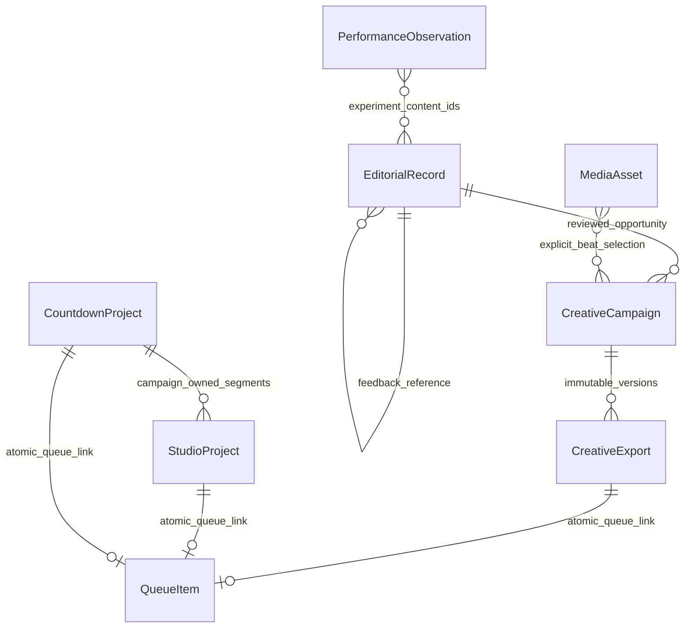

> **2026-10-18 continued checkpoint:** independent retrieval + owner review,
> atomic USD/credit reservations and scoped worker leases are implemented locally.
> The current contracts and limitations are in [LOCAL_CONTRACTS_20261018.md](LOCAL_CONTRACTS_20261018.md).
> Latest owner instruction: stay local; do not push, deploy or publish. Record every checkpoint in root MEMORY.md and the progress ledger.

# Local revival architecture checkpoint

Original system-wide maps and 24 root-cause findings remain in the Phase 0
audit package. This diagram adds the implemented safety and editorial paths.
Solid arrows describe code paths. External boxes are fixture replacements in E2E;
their presence does not mean a live provider was tested.

```mermaid
flowchart LR
  UI[Next owner interface] --> AUTH[Owner header / scoped media pass]
  AUTH --> API[FastAPI]
  API --> LF[Studio stage runner]
  LF --> FACTS[TMDB facts + typed credits]
  LF --> WEB[Grounded research drafts]
  WEB --> GATE[Claim references + evidence admission]
  FACTS --> GATE
  GATE --> SCRIPT[Saved script checks / repair recheck]
  SCRIPT --> PLAN[Narration + shot plan]
  PLAN --> VIDEO[FFmpeg final mux]
  API --> CD[Countdown identity + owned segments]
  CD --> LF
  CD --> STITCH[Final countdown stitch]
  STITCH --> QA[Decode / duration / streams / audio / black QA]
  VIDEO --> QA
  QA --> APPROVAL[Exact file + inputs owner approval]
  API --> ED[Opportunities / evidence / calendar]
  ED --> BRIEF[Owner-reviewed research fingerprint]
  BRIEF --> CAM[Selected native campaign treatments]
  ASSET[Hash-indexed cleared stills + provenance] --> CAM
  CAM --> EXPORT[Immutable native versions / captions / cards]
  EXPORT --> QA
  APPROVAL --> Q[Atomic queue link / review]
  Q --> CLAIM[Atomic submit claim + durable intent]
  CLAIM --> PROVIDER[One profile/platform request / client request ID]
  PROVIDER --> RECEIPT[Accepted receipt or unknown outcome]
  RECEIPT --> RECON[Read-only reconciliation]
  RECON --> ARCHIVE[Confirmed outcomes / archive]
  API --> OBS[Authorized imported metric observations]
  OBS --> COHORT[Format + platform + publication-age cohorts]
  API --> COMMENTS[Deidentified imported comment text]
  COMMENTS --> DRAFT[Private reply drafts / manual review]
  COMMENTS --> ED
  COHORT --> EXP[Recorded hypotheses + controls / descriptive results]
```

New tables: editorial_records, performance_observations, creative_campaigns,
creative_exports, media_assets. Additive existing-table columns: queue_items
media_kind/media_files, compilations queue_item_id. Disposable SQLite creation
and existing-table migration paths are locally exercised. PostgreSQL upgrade,
backup/restore, mixed-version deploys and rollback are not verified.

Studio stage writes now use generation-specific attempt folders; native campaigns
retain immutable export versions. Complete immutable history, restoration and
transfer/cache/deletion leases remain open. Publishing journals currently live on
the queue row; append-only attempt history and manual unknown resolution remain
open. Atomic USD/credit reservation and generation leases for scoped jobs are
implemented; legacy scrape/compile and residential handoffs remain release gaps.
See LOCAL_CONTRACTS_20261018.md for the three contract diagrams and limitations.

Research admission requires independently retrieved records plus explicit owner
semantic review with context, freshness and conflict checks. This does not turn
the storyboard model into a truth verifier or verify every structured TMDB claim.
Editorial opportunity excerpts remain owner-supplied; their approval has a
separate, clearly labeled scope.

Native creative treatment currently provides original beat cards and manually
selected stills. It does not implement semantic footage search, automatic legal
clearance, word alignment, complete campaign repurposing or creative excellence.
Private analytics and live comment adapters are unavailable; authorized imports
are honest local evidence, not a claimed connected-account capability.

Safe E2E uses a fresh marked temporary root, synthetic token/database/assets,
installed local speech, fake provider receipts, blocked external sockets and an
OS sandbox (macOS) or externally isolated container (Linux). Web-only mode and
safe-mode startup suppress schedulers, production recovery and maintenance.
