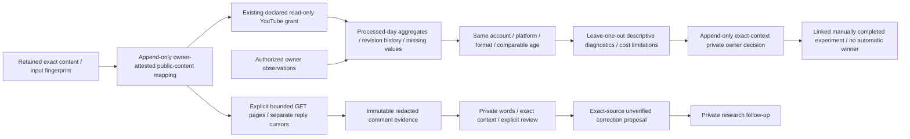
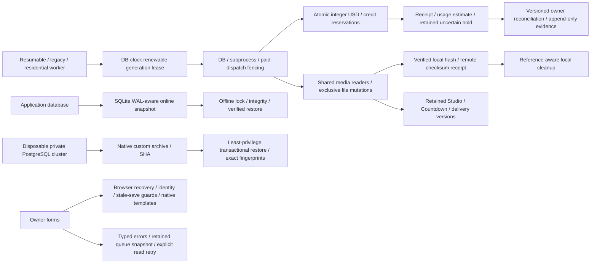
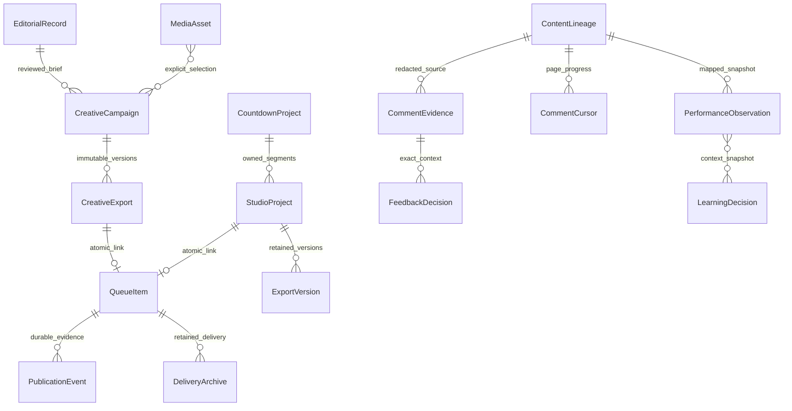
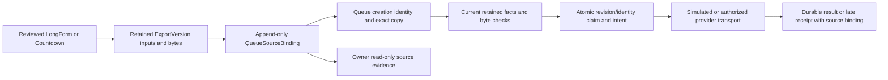

# Current local revival architecture — October 19, 2026

This describes the implemented local branch, not a deployed Screen Central OS
release. C01–C14 remain tracked in [REMAINING_ROADMAP.md](REMAINING_ROADMAP.md).
Continue local implementation, MEMORY.md and local commits without checkpoint
approval. The owner authorized GitHub push, deployment and live testing **when
implementation is finished**. No main merge, public media publication, account
change or paid call follows from that instruction. The later request defers the
entire Shorts archive and Drive login; those paths must stay idle.

Solid arrows are code paths. External adapters are replaced at the provider
boundary in local E2E. Actual databases, HTTP, UI, FFmpeg, original generated
assets and installed offline speech run locally; fixture success does not prove
provider compatibility, factual accuracy, permissions or creative quality.

```mermaid
flowchart LR
  UI[Next owner interface] --> AUTH[Owner header / scoped binary media pass]
  AUTH --> API[FastAPI lifespan / fail-closed initialization]
  API --> LF[Studio staged attempts]
  LF --> FACT[Typed metadata / claim references]
  FACT --> FETCH[Immutable independently retrieved source records]
  FETCH --> REVIEW[Owner semantic verdict / freshness / conflicts]
  REVIEW --> SCRIPT[Saved narration gate / recheck after edits]
  SCRIPT --> PLAN[Shots / plan / narration]
  PLAN --> RENDER[FFmpeg export]
  API --> CD[Countdown identity / eligibility / owned segments]
  CD --> LF
  CD --> STITCH[Exact segment release / final stitch]
  STITCH --> QA[Decode / streams / duration / loudness / timed spans]
  RENDER --> QA
  API --> BRIEF[Owner research / original angle / format choices]
  BRIEF --> CAM[Native campaigns / explicit selected assets]
  ASSETS[Authorized local still / video / audio catalog] --> SEARCH[Lexical tags / owner captions / provenance]
  ASSETS --> ANNOTATION[Append-only owner metadata/use decisions / exact-source CAS]
  ANNOTATION --> SEARCH
  ANNOTATION --> GATE[Current permission / source-version gates]
  GATE --> CAM
  SEARCH --> CAM
  CAM --> NATIVE[Immutable native exports / private manual packages]
  NATIVE --> QA
  QA --> ACCEPT[Exact-file editorial checks / finding decisions / rights attestation]
  ACCEPT --> Q[Atomic review queue link]
  ACCEPT --> MANUAL[Owner-header private package download]
  Q --> JOURNAL[Generation lease / durable per-target intent]
  JOURNAL --> PROVIDER[Transport / known receipt or uncertainty]
  PROVIDER --> RECON[Read-only reconciliation / owner evidence]
  RECON --> HISTORY[Retained delivery evidence and exact bytes]
```

Original catalog bytes/import provenance stay retained while append-only owner
decisions can correct searchable labels/captions or block future controlled use.
Native snapshots include stable catalog identity and effective provenance. Source
claims fence decisions against render/review/queue/dispatch; old content lineage
remains historical evidence. The owner can copy a saved campaign into a private
revised treatment and explicitly review changed research/source versions.

The catalog accepts authorized video/audio. Native Short/Reel-only campaigns
can select explicit video intervals with silent retained excerpts and intentional
hold/loop treatment. Explicit authorized background audio has separate intervals,
relative levels and silence/loop endings; audio-as-visual and incompatible mixed
formats reject. Short/Reel visual
treatments are still related beat cards. Image, carousel, community and poll have
format-specific copy; community/poll delivery is private/manual only. Native
approval now uses the same structured acceptance mechanism as the two studios,
with format-appropriate wording and full-manifest/inspection binding. Native review and format-specific transport checks passed full backend/PostgreSQL
lanes and four actual media browser workflows; exact evidence is indexed below.

YouTube analytics and comment adapters are implemented and tested against mocked
HTTP boundaries; real private authorization/report compatibility is unverified.
They never acquire scopes or post replies. Changed mappings fence old workers.
Missing observations stay missing; tiny/undersampled cohorts do not become
causal winners. Recorded variable-cost estimates and owner invoice attestations
remain distinct from verified provider invoices. Learning decisions grant no
spending, scheduling, publication or automation authority.

SQLite startup backup precedes migrations and fails closed. Restore and legacy
identity upgrade require exclusive offline maintenance locks. PostgreSQL has an
actual native logical backup/restore drill on a disposable local cluster,
including failed-restore rollback, append-only guards, sequence state, content
mutation detection and unchanged source fingerprints. Automatic app backups are
still SQLite-only. Production roles/ACLs, real volume recovery, scale/RTO,
retention, mixed-version rollout and Linux/container/CI execution remain open.
Automatic remote media/backup trash remains disabled. Docker remains off because
starting it resumed unrelated local workloads during an earlier check.

Relationships above describe logical evidence references; not all are foreign
keys, and append-only histories deliberately survive mutable queue/project
lifetimes. Database models also include leases, reservations, receipts, file
claims, source reviews, financial/publication decisions and remote-copy evidence.
Deferred archive models remain present without authorizing archive execution.

The current evidence index is in [SCRAPPER_COMPLETION_REPORT.md](SCRAPPER_COMPLETION_REPORT.md).
Detailed contracts: [local safety](LOCAL_CONTRACTS_20261018.md),
[media lifecycle](MEDIA_LIFECYCLE_20261018.md), [export acceptance](EXPORT_ACCEPTANCE.md),
[assets](ASSET_CATALOG.md), [native formats](NATIVE_FORMATS.md),
[selected video intervals](NATIVE_CLIPS.md), [background audio](NATIVE_AUDIO.md),
[audience lineage](AUDIENCE_LINEAGE.md), [comments](COMMENT_WORKFLOW.md),
[learning](LEARNING_DIAGNOSTICS.md), [database recovery](DATABASE_RECOVERY.md),
and [owner recovery](OWNER_RECOVERY.md). The progress ledger retains earlier
failures, corrective runs and historical counts; older counts are not current.

## Original-Studio queue source lineage

Countdown bindings include each exact retained segment and current eligibility
evidence. Legacy unbound Studio rows require an explicit reviewed resend; queue
copy/cover changes require revising the source. Working render/cover revisions
can coexist with retained queued bytes. This is typed consistency plus owner
acceptance, not independent complete truth or legal certification. See
[queued source contract](QUEUED_STUDIO_SOURCES.md) and [credit context](CREDIT_CONTEXT.md).

## Legacy Countdown draft recovery and parent-owned workers

A saved legacy list uses an explicit owner/context-CAS recovery action, retaining
its words/media/history before clearing unproven child links and approval. A new
current draft must confirm category/count/rationale, create independent children
whose context binds parent creation identity, review bookends and accept the new
export. The common Studio runner claims the parent source and validates membership
and current category facts before undo/paid work. Scheduler recovery does not
automatically spend on old lists. Candidate-topic titles cannot silently fill
gaps, discard entries, invent rationales or shrink formats. See
[Countdown saved contracts](COUNTDOWN_SAVED_CONTRACTS.md). Full30 actual local UI
proof is separate from the next database-clock admission refinement.

## Supported Countdown formats and exact acceptance verified

Only Top5/Top10/Top15 admit current work, with the exact requested entry count.
Unsupported saved formats remain readable with original words/media/history;
they cannot be silently converted or promoted through legacy recovery. A live
parent lease is preserved before stopped-work recovery. Immutable export inputs
and the final fingerprint retain requested format. Acceptance records that exact
format; retained dispatch requires explicit format/count/acceptance proof and
never infers it from a changed live draft. Older formatless exports need current
review/resend. The interface displays the format and explains supported recovery.

Full backend **799passed/1optional skip77.86s**; actual PostgreSQL **321passed37.23s**,
native restore **1.233s**,214393bytes,source unchanged,SHA
0d5e4639e11b7e3762d2279e1b08302ad56d1d2c5943acf5bd0b0948a876384c.
Production build2/explicit tsc1 passed. Pre-final-live-owner-guard full browser
**31passed6.6min** is retained separately in history/countdown-format-admission1.
Final source scoped browser **2passed1.3min** covers actual Top5 media/render,
explicit requested-format acceptance and immutable queue source, plus unsupported
format readable/no-conversion/disabled-work behavior. SourceSHA
5e8c1277ccfc172d4661e674eba8a733e01583dea4e5d0432ac380a847fdef09;
evidence artifacts/e2e/history/countdown-format-admission2; verified WAL-aware
snapshotSHA96990334c1acca28b8d924bf0d618a706c53f0bd52d74805da0c104dd640eeab.
Format acceptance screenshot inspected. Original synthetic assets/offline speech
are actual; provider/cloud services simulated; external spend$0. Owned stack
stopped after preserving media/source/runtime ledgers/reports/traces/snapshot.
These results do not close specialized category/editorial/semantic or C01–C14.
No archive/auth/paid/public/account/push/deploy action.

## Local category Boolean meaning verified

Category criteria version2 keeps genre, production-country and provider and/or
lists independent. An unrelated provider alternative cannot relax required
genres; an explicit country conjunction needs both production countries.
Recognized longest aliases and explicit inclusive year ranges/single
before/after/since/until bounds are supported. Mixed or cross-filter alternatives,
compound/disjoint temporal conditions and unsupported exclusions require
rephrasing/independent proof before retrieval or child creation. This is a bounded
parser, not general language or complete category truth. Saved v1 proofs cannot
borrow v2 meaning at parent, direct-child or retained delivery admission; original
words/media/history are preserved and current confirmation is required.

Initial independent corpus14failed/8passed; expanded focused67passed1.16s.
Full backend830passed/1optional skip91.75s; actualPG352passed38.52s/native restore
1.188s214730bytes/source unchanged/SHA
42670c658f79f99220e649368d6f345bf5f0e27a8be991c8047efd4a5a17b034.
Production build1/tsc1passed. Full32 browser run:31existing flows passed7.3min,
new category case failed an incorrect dialog expectation after actual expected409
and inline message. The corrected category case then passed5.3s (run6.2s) on an
identical indexed backend source, with actual local-filter display and unchanged
ranking/no segments after refusal. These are separate runs, not an all-green
single full32 execution. Initial nested-details locator failure is also retained.
Evidence history/countdown-category-logic1/2/3; sourceSHA
a03e7d93ac2614ed58a7230a6789d361d4d0c0ef4708a816958bd49c54aa2253;
latest verified snapshotSHA5d97b8d3f938033c78f1ddd7fc7bf0856afa7922e30b45e539a31b2a481834bf.
Reports/traces/exact executed specs/original generated media/frozen source/runtime
ledgers/fakeDrive/snapshots retained; owned stacks stopped. Blocked-category
screenshot inspected. Providers/cloud simulated, externalspend0. Subsequent
requested-duration work is a separate unstaged source; no proof inferred for it.
Specialized categories/semantic/editorial quality and the wider roadmap remain.
No archive/auth/paid/public/account/push/deploy action.

## Requested/delivered length and permanent acknowledgment verified

Requested length is independent of the mux timeline. Studio final review shows
its saved approximate export target; Countdown review retains the exact requested
per-title/total segment length, excluding added bookends. Actual measured length
outside a25% band requires an explicit editorial decision. This is a review
heuristic, not a quality score or hard length requirement. No words are padded or
rewritten. Exact fingerprints and immutable export inputs retain the target;
custom Countdown length changes preserve old bytes/intent and revoke current
render/acceptance. Normal36s Top15 children remain valid. Explicit invalid0/False
historical settings remain unconfirmed rather than inheriting a default.
Retained delivery refuses missing/malformed/future target proof; it never borrows
a changed live draft's target. Owner source inspection displays retained intent.

A real browser regression also reproduced acknowledgment returning silently when
an edited decision was restored to identical text. Every checklist/decision/rights
edit now clears acknowledgment permanently until the owner checks it again.
Actual browser tests cover clearing and restoring each field, required deviation
decisions, requested/delivered display, retained main/child targets and ordinary
LongForm/Top5/legacy/native delivery boundaries.

Initial duration corpus6failed/3passed; extra subminute/invalidsaved cases3failed,
then focused16passed1.87s and compatibility74passed1.83s. Final backend
846passed/1optional skip82.87s; actualPG368passed39.55s/native restore1.163s,
219072bytes/source unchanged/SHA
a45b7ef4e6ad9a88d509d4133448ad39b2c693d785676dea361be9f5c7d4ec05.
Production build2/tsc2passed. Fresh full browser32passed6.6min, sourceSHA
5fc2a05f88416d1b16eb9ce7080e02e59e4a584ed372914e108c9d00cd4efadd,
evidence history/requested-duration2; verified snapshotSHA
fe98a80ede53b756b04f38dbdd24eb3ba1dfacde3dd29693aafe1ad689f64ed4.
All media/runtime/frozen source/reports/traces/exact spec/snapshot preserved and
owned stack stopped. Length-review screenshot inspected. The first55.4s failed
acknowledgment repro remains separately in history/requested-duration1.
Original synthetic footage/offline speech actual; provider/cloud simulated;
externalspend0. These6s/81s fixtures do not prove excellent3min/8min narratives.
Wider semantic/caption/editorial/media/provider/operational work remains.
Next shared-TTS-cache changes are separate and not included in this full32 source.
No archive/auth/paid/public/account/push/deploy action.

## Narration cache ownership verified

Each TTS cache key, unique provider temporary file and destination is protected
by a bounded cancelable database writer claim. Concurrent misses recheck after
ownership and share the completed generation; cache hits copy before releasing
ownership. LRU cannot remove a live source/partial response. Generation loss
blocks promotion. A busy error from the consumer body never repeats that work.
The120s wait is bounded; an unusually long provider attempt can leave a later
consumer with an explicit busy/retry error. No extra request is made by waiting.

Broad TTS directory reader claims were removed from Studio/Countdown wrappers to
avoid reader-to-writer deadlock between projects. Protection now lives in the
common synthesizer, including native and compilation callers. Shared motion/audio
directory readers remain for their separate lifecycle. These contracts do not
prove real speech-provider billing, perfect audio or every process crash scenario.

Four corrected independent failures reproduced cache-reader/temp-write eviction
and duplicate generation both directly and through actual Studio runners.
Focused33passed1.99s includes cancellation/boundedwait, one-body execution and
revoked generation. Full backend853passed/1optional skip98.13s; realPG375passed
40.16s/native restore1.572s219372bytes/source unchanged/SHA
0fe85a4c7ca067f494dd6257dd86ea18084ad6077394db9a5303f9a3acbca39b.
Production frontend unchanged from durationbuild2; explicit tsc1passed.
Fresh scoped3 browser passed2.3min: actual LongForm,Top5 and nativeShort/carousel
now exercise productiontts.synth/cache, replacing only the provider with installed
offline speech. Five independent segments share one common-phrase generation;
14completed offline provider receipts atTop5 review have exact matching cached
bytes and zero cloud calls. Root fake-speech ledger labels its simulated boundary.
This is actual common-cache integration, not cloud speech/billing proof.
SourceSHAf7c58e31ebd365c3bb696d0601b30f6a199089af34d2568d667e100d3402f770,
evidence history/tts-cache-ownership1; full reports/traces/media/source/runtime
ledgers/fakeDrive/verified snapshot retained; owned stack stopped. Prior full32
is separate pre-cache source5fc. The wider C01-C14 roadmap remains unfinished.
No archive/auth/paid/public/account/push/deploy action.

## Motion cache ownership, private inputs and abandoned work verified

Motion pieces now use one database-fenced producer per key and a unique work
namespace. Source assets stay pinned across digest/input copying. A lost owner
cannot promote completed CLI bytes. Main render consumers receive private,
atomically completed input copies before the cache claim is released; global
cache eviction afterward cannot remove their inputs. Copy failure preserves a
prior private piece and removes partial-copy space. Successful final inspection
releases the consumed private intermediates. Static piece fallback and explicit
cancellation keep their existing boundaries.

Broad motion-directory readers were removed after converting consumers. Per-key
claims avoid the former shared-reader upgrade deadlock. Cache warmup returns a
transient cache handle; later composition explicitly materializes its own input.
Ordinary cache reclamation now recognizes only declared schema1 kind/hash/UUID
work directories, matching their marker. Live claims, including the current
invocation's own work, prevent deletion. Expired work may be reclaimed and the
old owner is fenced. Unmarked/future/bool-schema/symlinked paths stay untouched.
This is managed disposable-work cleanup, not remote or arbitrary asset deletion.

Initial4failures reproduced simultaneous work deletion, missing owned-copy
capability and stale-owner promotion. A new nested-cleanup case reproduced and
fixed same-invocation deletion. Focused12passed6.35s includes actual FFmpeg
composition after every shared motion-cache file was evicted. The CLI boundary
supplies original generated MP4/ProRes fixtures; it does not run HyperFrames/Chrome.
Existing compositor/fallback/lease tests also passed. Broad1 had867passes plus an
outdated disk-test fixture failure; corrected capacity-state fixture preserves
backup-first/Drive-before-delete/stop-under70% behavior. Final full backend
868passed/1optional skip93.51s; realPG390passed53.87s/native restore1.183s,
222183bytes/source unchanged/SHA
a917686daf760377684b5db26bc0884977f9760bd0585f4e11611e86e848dfb0.
Fresh full32 browser passed6.8min on frozen sourceSHA
a480e0ea8459e3340e2ccc7a368770345173cc47b1c125670abe7f3f5dbb0c63.
Only the unit disk-fixture correction is later; production code is identical.
Safe E2E motion mode remains explicitly off: browser evidence is regression and
production-TTS-cache proof, not real HyperFrames environment proof. Frontend
unchanged from durationbuild2/TTStsc1. Evidence history/motion-cache-ownership1
includes source/spec/media/traces/runtime ledgers/fakeDrive and verified snapshot
SHA40204406b1593a13fc9c9192ad05ad3f00caa38101758721f038820a611200a2;
owned stack stopped.

A retained single compositor run passed5.22s. Actual4.0s MP4, measurements, probe,
frames, complete test data/snapshot and exact source are saved in
artifacts/motion-cache-media1. VideoSHA
9de98f6d76e6a311fd59d6efe6422248c4c0f0cc2cb717f92c9c3cc550799fde,
sourceSHAf4dd7bbb2091007271b6ec92f648c175cb52543f8c538702f0ef98eb24810709.
Inspected frames show the intended synthetic alpha-overlay/color fixture; this
is not an editorial/design/speech-quality example. Original local footage/tone,
actual FFmpeg, simulated CLI/provider/cloud, externalspend0. The real renderer
environment and wider roadmap remain unverified. No archive/auth/paid/public/
account/push/deploy action.
