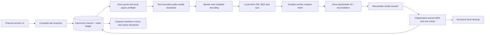

# Authorized channel archives

Owner scope: all available Shorts from the ten sources in ARCHIVE_CHANNELS.json,
organized under Movie Clips. Do not create publishing-queue items, assign posting
accounts, mark Ready, schedule or publish. Wait for the owner's next instruction
after the archive. Regular uploads and public archived livestream tabs are
supported separately; they are not selected for this owner's batch.



The Shorts tab defines Shorts membership; duration alone is not a classification.
The yt-dlp continuation iterator is fully consumed without playlistend limits.
Unavailable tabs are incomplete inventories, never a claim that no historic
videos exist. Entries missing from a later inventory keep their previous records
and successful remote copies. Titles are descriptive metadata; canonical IDs
identify originals. Successful media is never overwritten after a title change.

The old channel-ingest HTTP endpoint now inventories Shorts first. Legacy resumable
channel-ingest jobs use the same archive ledger, reject automatic approval and
never create queue rows. The old max_videos field is deprecated and defaults to
zero; full archive enumeration has no count cap. Shared Drive folder IDs are
supported. Escaped Drive queries preserve names containing apostrophes.

Transfers are sequential. Local temporary space must hold a bounded transfer and
reserve. Known remaining estimates are compared with Drive quota. Unknown sizes
stay explicit. User storageQuota does not expose Shared Drive pooled capacity;
that case is reported as unknown and quota errors stop the run. Files remain in
channel_archive/<channel>/<video>/ until independent checksum/size verification
is committed. Metadata creation intent is committed before the Drive call.
After a lost creation response, appProperties reconcile the canonical identity;
a no-match ambiguous creation is not blindly repeated. Multiple matches or
nonmatching nonempty bytes stop for reconciliation. A verified upload whose
response was lost can complete on retry without downloading/uploading it again.

Stop fences the archive's generation lease, kills controlled server processes,
and preserves verified copies plus unfinished local files. An expired process
cannot promote ledger writes. External requests already in flight still need
reconciliation. Retry/resume and refreshed counts are available in the owner UI.
A per-channel JSON manifest records URLs, IDs, titles, dates, durations, formats,
bytes, hashes, Drive IDs, errors and processing status. The server database is the
authoritative ledger; the Drive manifest is a checksummed materialized snapshot.

Public access only for this archive adapter: no credentials, proxy rotation,
CAPTCHA bypass, DRM bypass or bot-control tricks. Conservative request spacing,
bounded retries and access-challenge logging are used. No guarantee about bot
classification is made. A missing/private/restricted item is recorded; a rate
limit or access challenge stops the channel to avoid repeated requests.

Evidence so far: 13 focused backend tests passed with original generated video
bytes and simulated Drive; 31 combined archive/lease/undo tests passed. Production
build2 passed. Actual Playwright import UI archive-browser5 passed (12.8s): 63
entries, real ffprobe/full decoding and hashes, simulated lost transfer response,
reload/retry, remote deduplication, unchanged queue count and downloaded manifest.
Source generation a0ceba9d1e6f9852c786f037bcae2d26096a28d364899714ab5102d2b6dcf6d8.
All ten public canonical identities have been independently resolved; Tiny Friends
TV's Shorts tab is currently unavailable to the extractor. No real video has yet
been downloaded from these channels, and no real Drive upload is claimed.

API references checked during implementation:
[Drive files.create](https://developers.google.com/workspace/drive/api/reference/rest/v3/files/create),
[Drive about.get](https://developers.google.com/workspace/drive/api/reference/rest/v3/about/get),
[yt-dlp options](https://github.com/yt-dlp/yt-dlp/blob/master/README.md).


## Mac handoff and actual inventory

The owner UI's Send to Mac worker action queues an explicit archive handoff. The
existing local_worker --watch loop handles those channels; it does not auto-retry
challenged channels. A direct command is:

```
python scripts/archive_worker.py --channel CANONICAL_UC_ID
python scripts/archive_worker.py --inventory https://www.youtube.com/@handle
```

SERVER_URL and ACCESS_TOKEN come from environment or local ignored deploy.env.
Keep server tokens out of public command examples. No Drive credentials are sent
to the worker. It renews the channel claim, takes one missing item, retains local
bytes until a verified matching server receipt, and preserves files after an
uncertain response. Stop in the UI revokes the generation. The download process
also terminates on lease loss. Multiple Macs and a server archive cannot own the
same canonical channel simultaneously.

ARCHIVE_INVENTORY.json records the actual public enumeration:4004 Shorts across
nine complete channels, all byte-size estimates unknown. Tiny Friends TV currently
has no public Shorts tab and its visible content differs from the screenshot.
That source remains incomplete. No actual source video or real upload is claimed.

The real Movie Clips folder is a personal My Drive folder. The currently configured
service account can read it but reports zero storage quota. Actual uploads need an
existing owner-authenticated path or a writable Shared Drive. The optional
GOOGLE_DRIVE_AUTHORIZED_USER_JSON setting accepts an existing authorized-user
credential or local path; it does not establish new scopes/grants. Owner input on
the usable upload path is pending. Quota0 preflight stops before media download.
