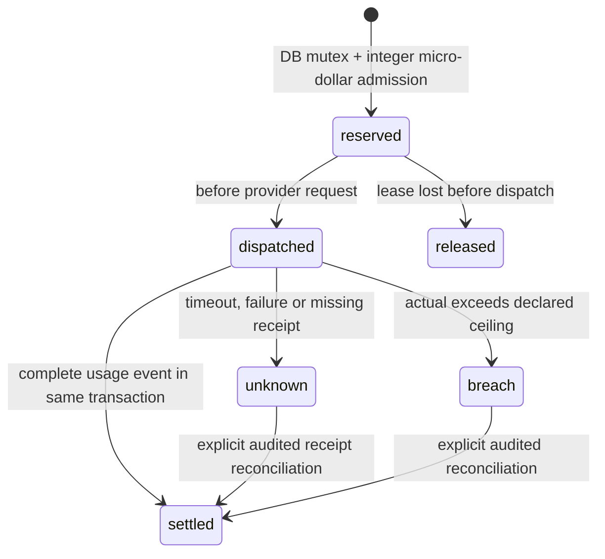
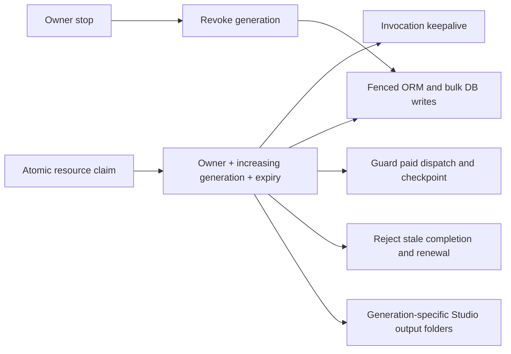

# Local evidence, budget and lease contracts — 2026-10-18

This checkpoint follows the owner's requested order. It remains local, on the isolated feature branch. No push, deployment, publication, live account change or paid request was performed. Tests use disposable SQLite and fake provider boundaries; external spend is $0.

## Independent evidence retrieval and review

Source records and claim reviews are separate database rows. Model-provided excerpts, hashes and review IDs cannot independently authorize a fact. Retrieval removes scripts/styles and accepts only bounded uncompressed HTML or plain text from the existing editorial allowlist. Network tests replace the transport and DNS; no real article was fetched in this session.

A phrase appearing in a denial is not automatically support. Semantic support is an explicit owner decision with rationale and a context confirmation. This is independent retrieval plus human review, not an autonomous truth engine or evidence that every TMDB fact is independently correct. Structured TMDB facts, trailer analysis, provider availability and native opportunity briefs still have distinct provenance and require broader material-claim verification. There is no general cross-source contradiction resolver.

Changing reviews invalidates narration checks and downstream work while preserving owner words. Stored web findings are rechecked for freshness before plan/render/enqueue through the saved storyboard gate. Raw TMDB details remain visible. Owner-reviewed verdicts are labeled as such, with freshness checked at use time.

## Atomic budget reservations

SQLite writer serialization / PostgreSQL row locking protects admission across sessions and processes. Daily and monthly budgets include every unsettled USD hold, including holds from previous days/months. Monthly admission includes fixed costs. Each retry reserves separately. Accounting errors propagate; work does not silently continue without a durable receipt. Missing usage is recorded as unresolved rather than zero-cost success. Chirp free-tier accounting is serialized.

Known text calls derive a conservative token bound from UTF-8 request bytes and the request's output-token limit. Unknown models, image/audio requests and grounding fan-out require explicit positive `costs.request_bounds["service:model"]` ceilings. These settings describe operator-declared cost contracts; they do not certify current provider pricing or guarantee an external invoice. No values were configured on any live account. Requests without a bound stop before provider IO, including the existing unbounded Gemini speech routes.

The spending card includes reserved funds and explains that uncertain holds survive midnight. The original USD reservation endpoints remain available. The expanded owner-authenticated `GET /api/financial/holds` and `POST /api/financial/resolve` workflow covers both USD and credit holds, including interrupted reserved/dispatched attempts. It requires exact version, UUID idempotency key, provider receipt, rationale and explicit interruption review where needed. Renewable financial request leases prevent decisions while the provider call is live. Append-only decisions and late usage receipts retain disagreements; a new decision must explicitly resolve a mismatch. Settings exposes this workflow and declared per-request USD bounds.

vidIQ has an independent integer-credit ledger/hold table under the same DB mutex. Unknown tool prices fail closed; timeouts preserve the hold and paid tool calls are not blindly retried. Existing price entries are estimates, not a verified current provider tariff.

Remaining budget work: real provider invoice matching, confirmed price/usage ceilings and refund allocation across calendar boundaries. vidIQ configured estimates remain separate from owner-supplied exact receipts. Holds never expire into available money. Missing credentials are rejected before credit admission.

## Worker leases and fencing

Applied to resumable Studio/Drive/bulk jobs, Countdown research/render/Drive, synchronous native campaign renders, legacy ingest/compile and residential worker claims. Resume claims compare the scanned job state and acquire the expired resource in one transaction. A process cannot launch the same owned invocation twice. Expired leases cannot revive themselves. Worker-thread helpers inherit the parent lease context. Keepalive also operates for owner-triggered work in web-only mode.

Studio assets, footage, stills, narration and render files use attempt folders. Old workers can leave abandoned files in their own folder, but cannot promote their database pointer over a later generation. Previous immutable segment-cache entries are copied into the new attempt to preserve reuse. Archive discovery recognizes the new folders. Native exports already have separate immutable version folders; a render left running by a dead process can recover after lease expiry without replacing old exports.

Residential protocol v2 uses server-issued claims, renewal, bounded full-decode multipart uploads and hash-bound durable receipts. The real client/server exchange has localhost browser evidence with only downloads replaced by synthetic footage. Shared/exclusive file claims now cover core render/transfer/cleanup paths; remaining stream/trash integrations are listed in MEDIA_LIFECYCLE_20261018.md. Limits: External services cannot be fenced by a local database token: in-flight delivery remains governed by persisted intent, idempotency keys and unresolved outcomes. SQLite lease concurrency and separate-process USD reservation tests ran; PostgreSQL behavior, clock-skew handling and rolling deployment with old worker versions have not been exercised. Do not deploy this as an all-workers release contract.

## Verification

Use the latest logs referenced by `SCRAPPER_COMPLETION_REPORT.md`. New tests cover unsafe source URLs and mixed private DNS, pinned redirect retrieval/content bounds, denial-versus-support review, changed identities and stale records; concurrent USD reservations in separate sessions and Python processes; timeout holds across month boundaries; atomic settlement and explicit audited resolution; simultaneous credit attempts; stale worker writes, bulk writes, renewal, completion and paid admission; stop revocation; duplicate local invocation; and native crash recovery.

The browser corpus adds the real review UI: retrieve fixture record, inspect it, submit an explicit verdict, invalidate narration, recheck saved words and reload the durable record. Transport fixtures are declared as fixtures; this does not prove live article extraction or live provider compatibility.

Earlier contract checkpoint: backend **395 passed /1 optional skip /37.16s**, browser3 **6 passed /2.4min**, production frontend build and TypeScript passed. Subsequent worker/publication/financial/media/draft work expands this corpus; the completion report and progress ledger record the latest runs. Backend thread exceptions are test errors. All local runs use isolated provider fixtures and $0 external spend. Live-provider, PostgreSQL, complete kill/restart and deployment limitations remain.
